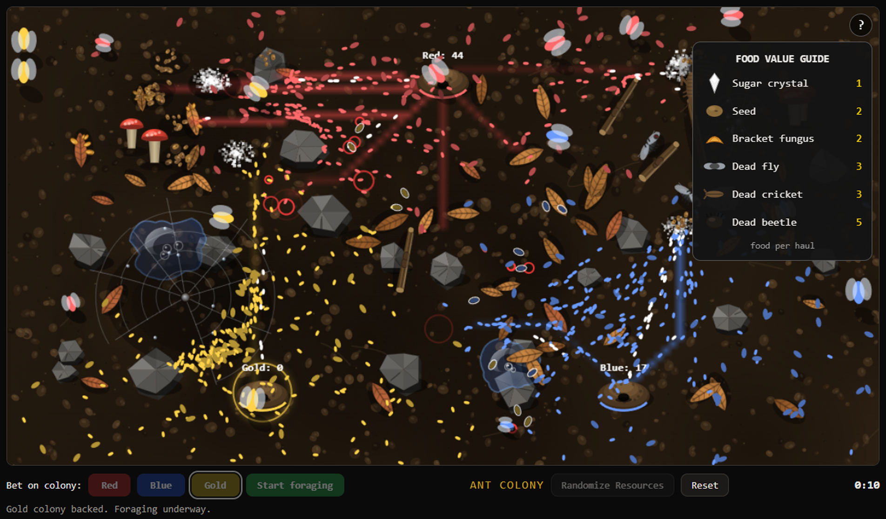

# ANT COLONY

A zero-input spectator simulation: 1,000 ants across three colonies (Red, Blue, Gold) forage, fight, and survive on a living battlefield. Bet on a colony before pressing Start — first to bank **500 food** wins.

## How to play

1. Open `index.html` in a browser (or visit the GitHub Pages deployment).
2. Click **Red**, **Blue**, or **Gold** to place your bet.
3. Press **Start foraging** and watch.

No input after that. The game plays itself.

## The simulation

**Castes** (334 ants per colony):

- **Scouts** (~20%) — fast, discover food, lay pheromone trails, deploy workers
- **Workers** (~75%) — haul food home; ~2.5% are **fliers** that soar over terrain at 2× speed
- **Warriors** (~5%) — hunt rival ants, marked with a white ring

**Food** (value per haul): sugar crystal (1), seed (2), bracket fungus (2), dead fly (3), dead cricket (3), dead beetle (5).

**Terrain**: fallen leaves (slow ants, drift when crawled over), water droplets, rocks, twigs, mushroom clusters, spider webs.

**Predators & hazards**:

- **Spider** — raids webs every 60s, devours trapped ants
- **Assassin bug** — prowls every 30s, snatches ants (even mid-flight); slowed 40% in webs
- **Spider webs** — trap ants 2.5–4s; safe from rival ants while stuck
- **Wind gusts** — every 30s, blow leaves across the map

**Colonies rebuild** at 3 ants/sec once reduced to 33 or fewer.

## UI

- **Live ticker** — color-coded event feed (purple: spider/webs, pink: assassin, red: combat, green: milestones, orange: rebuilding, gold: victory, blue: wind)
- **Live stats** — food banked with progress bars, caste counts, kills by caste
- **Food Value Guide** — click the `?` on the canvas
- **Victory overlay** — survivor counts, casualties by caste, Food Over Time chart, Kills by Cause chart, full Play by Play replay
- **Randomize Resources** / **Reset** — reshuffle terrain or start clean

## Files

| File | Purpose |
|---|---|
| `index.html` | Page structure, UI, meta tags |
| `ant_styles.css` | All styling |
| `ant_script.js` | Full simulation + rendering |
| `favicon.ico` / `favicon.png` | Ant favicon |
| `og-image.png` | Social share image (1200×630) |

## Deploying to GitHub Pages

1. Create a repo and push these files to `main`.
2. Settings → Pages → Deploy from branch → `main` → `/ (root)`.
3. Your game is live at `https://<user>.github.io/<repo>/`.

## Tech

Vanilla HTML/CSS/JS — no dependencies, no build step. Canvas 2D rendering. Procedural Web Audio (mutable).

---

Built with [Muse](https://muse.ai) (Clanker).
